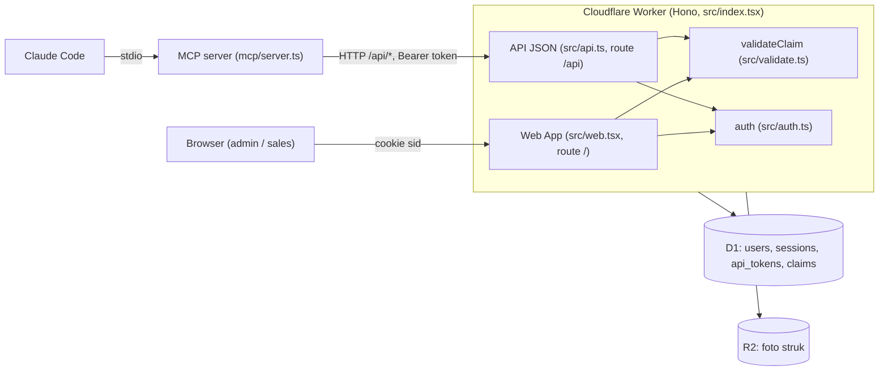
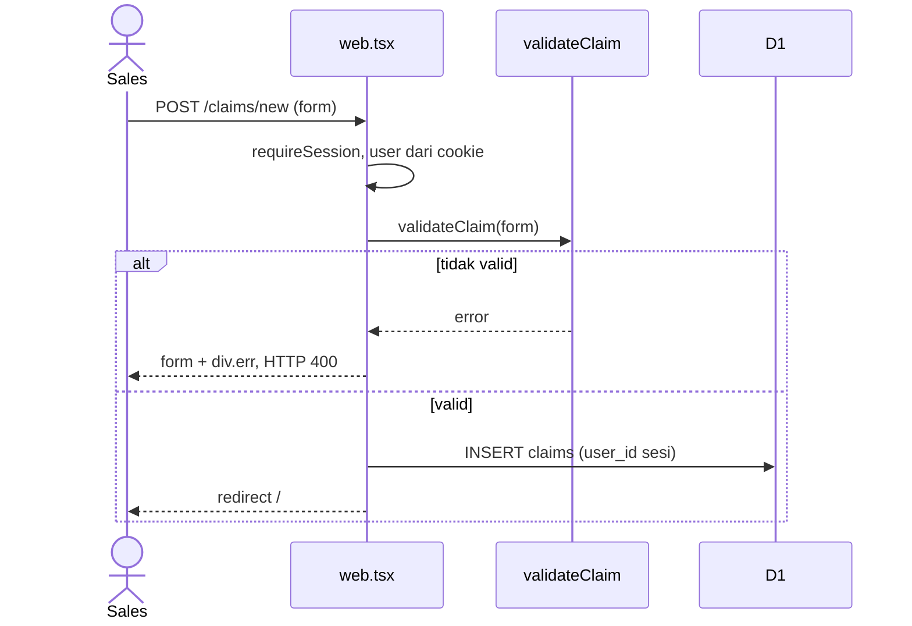
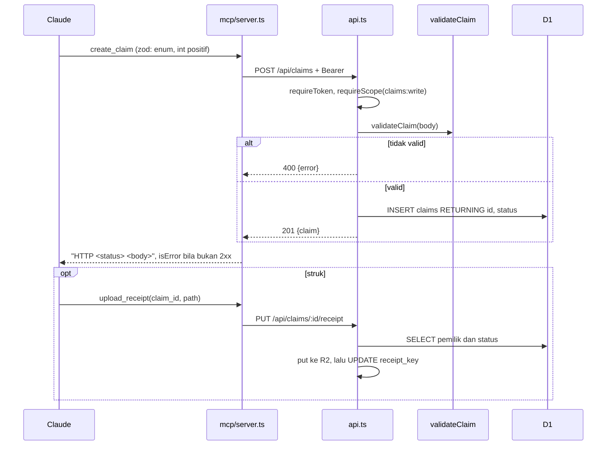

# Arsitektur ops-finance

Peta `src/`, `mcp/`, dan `migrations/` per 2026-10-21, dipakai sebagai dasar implementasi [PRD plafon klaim](PRD.md). Data dummy, untuk lab.

Legenda: **[Terverifikasi]** dibaca langsung dari kode, nomor baris dicek ulang. **[Asumsi]** belum dibuktikan dengan kode atau eksekusi, perlu dicek sebelum dijadikan dasar keputusan.

## 1. Container

| Container | Isi | Lokasi |
|---|---|---|
| Worker | Satu app Hono. `/api` ke `api`, `/` ke `web`. | `src/index.tsx:6-8` |
| Web App | HTML di-render server dengan Hono JSX dan CSS inline. Tidak ada file HTML terpisah. | `src/web.tsx` |
| API | JSON, semua route lewat `requireToken`. | `src/api.ts:7` |
| Auth | Cookie `sid` untuk Web App, Bearer token untuk API. | `src/auth.ts:22`, `:35` |
| D1 | Binding `DB`, skema di `migrations/0001_init.sql`, seed di `0002_seed.sql`. | `wrangler.jsonc:4-6` |
| R2 | Binding `RECEIPTS`. Hanya API yang menulis, Web App membaca dan menghapus. | `wrangler.jsonc:7-9` |
| MCP server | stdio, tiga tool, memanggil `/api/*` dengan token dari env. | `mcp/server.ts`, `.mcp.json` |

**[Terverifikasi]** Web App tidak punya upload struk. Form (`src/web.tsx:129-145`) tidak punya field file. Satu-satunya jalur tulis ke R2 adalah `PUT /api/claims/:id/receipt` (`src/api.ts:48`).

### Route

| Method dan path | Handler | Akses |
|---|---|---|
| `GET /api/me` | `src/api.ts:9` | token valid |
| `GET /api/claims` | `src/api.ts:12` | scope `claims:read`. Sales hanya klaim miliknya (`:18`), admin semua. |
| `POST /api/claims` | `src/api.ts:25` | scope `claims:write`. `user_id` selalu dari token (`:33`). |
| `PUT /api/claims/:id/receipt` | `src/api.ts:38` | scope `claims:write`, pemilik klaim saja (`:41`), status `submitted` saja (`:42`). |
| `GET`, `POST /login`, `GET /logout` | `src/web.tsx:51`, `:66`, `:77` | publik |
| `GET /` | `src/web.tsx:87` | sesi. Sales hanya miliknya (`:92`). |
| `GET`, `POST /claims/new` | `src/web.tsx:147`, `:148` | sesi mana pun, `user_id` dari sesi (`:154`) |
| `GET`, `POST /claims/:id/edit` | `src/web.tsx:160`, `:165` | `adminOnly` |
| `POST /claims/:id/status` | `src/web.tsx:175` | `adminOnly`, hanya dari `submitted` (`:178`) |
| `POST /claims/:id/delete` | `src/web.tsx:181` | `adminOnly` |
| `GET /receipts/:id` | `src/web.tsx:190` | pemilik atau admin (`:193`) |
| `GET`, `POST /tokens`, `POST /tokens/:id/revoke` | `src/web.tsx:200`, `:226`, `:244` | sesi, token milik sendiri (admin: semua) |

Tidak ada endpoint API untuk edit, hapus, atau approve. Tool MCP hanya `list_my_claims`, `create_claim`, `upload_receipt` (`mcp/server.ts:22`, `:28`, `:42`), sesuai aturan CLAUDE.md. **[Terverifikasi]**

### Akses DB

Semua query memakai `prepare(...).bind(...)`. Dua query menyusun teks SQL dari potongan tetap, nilai tetap lewat `bind`: `src/api.ts:15-21` dan `src/web.tsx:90-95`. **[Terverifikasi]** Tidak ada nilai dari user yang masuk ke teks SQL.

### Aturan akses

- Sales hanya melihat dan membuat klaim miliknya: `src/api.ts:18`, `:33`, `:41`; `src/web.tsx:92`, `:154`, `:193`. **[Terverifikasi]**
- Admin-only lewat `adminOnly` (`src/web.tsx:159`), dipasang di edit, status, dan hapus. **[Terverifikasi]**
- Token disimpan sebagai hash SHA-256 (`src/auth.ts:8-11`, `src/web.tsx:229-232`), dicari lewat `token_hash` (`src/auth.ts:41`). Plaintext tampil sekali saat dibuat (`src/web.tsx:237`). **[Terverifikasi]**
- Role dan scope diambil dari JOIN `api_tokens` ke `users` (`src/auth.ts:39-46`). MCP server tidak punya otorisasi sendiri, semua diputuskan API. **[Terverifikasi]**

## 2. Alur ajukan klaim

### Web App

Kode: `src/web.tsx:148-156`. Validasi di `:150`, INSERT di `:153`. Tidak ada upload struk di jalur ini.

### MCP

Kode: `mcp/server.ts:28-40` (tool), `:10-17` (`call`), `src/api.ts:25-35` (POST), `src/api.ts:38-51` (struk).

**Titik berbagi:** `validateClaim` dipanggil dari `src/web.tsx:150`, `src/web.tsx:168` (edit), dan `src/api.ts:27`. MCP tidak memanggilnya, hanya zod di `mcp/server.ts:30-36` yang mengulang enum kategori. API memvalidasi ulang, jadi zod tidak bisa menyimpang tanpa terdeteksi. **[Terverifikasi]**

**Jalur tulis yang menyentuh `amount`, `category`, `claim_date`, atau menambah klaim yang dihitung:**

| Jalur | Lokasi | Perlu cek plafon |
|---|---|---|
| Buat klaim Web | `src/web.tsx:153` | ya |
| Buat klaim API/MCP | `src/api.ts:30` | ya |
| Edit admin Web | `src/web.tsx:171` | ya |
| Ubah status | `src/web.tsx:178` | tidak (default PRD, lihat bagian 4) |
| Hapus | `src/web.tsx:185` | tidak, memulihkan sisa |
| Upload struk | `src/api.ts:49` | tidak |

## 3. Temuan

Bobot: **Tinggi** memengaruhi implementasi PRD langsung, **Sedang** perlu diputuskan, **Rendah** catatan di luar lingkup PRD.

| # | Temuan | File dan baris | Status | Bobot |
|---|---|---|---|---|
| F-1 | `validateClaim` sinkron dan murni, tidak ada akses DB. Plafon tidak bisa ditaruh di sana apa adanya. | `src/validate.ts:13` | Terverifikasi | Tinggi |
| F-2 | Dua INSERT terpisah, tanpa pengecekan lain. Pola cek-lalu-tulis belum ada, jadi PRD harus membuat INSERT bersyarat di kedua tempat. | `src/api.ts:30-33`, `src/web.tsx:153-154` | Terverifikasi | Tinggi |
| F-3 | Edit admin tidak membaca klaim lebih dulu. Pemilik (`claims.user_id`), status, dan nilai lama tidak diketahui. Id yang tidak ada diam-diam redirect. | `src/web.tsx:165-173` | Terverifikasi | Tinggi |
| F-4 | Edit bisa mengubah `amount`, `category`, `claim_date` klaim `approved` dan `rejected`. UPDATE tanpa kondisi status. | `src/web.tsx:171` | Terverifikasi | Tinggi |
| F-5 | Penolakan validasi API memakai HTTP 400. PRD minta 422 untuk plafon, jadi dua kode berbeda di endpoint yang sama. | `src/api.ts:28` | Terverifikasi | Sedang |
| F-6 | `test/helpers/env.ts` hanya menerapkan `0001` dan `0002`. Test plafon tidak melihat tabel `category_limits` sebelum `0003` ditambahkan di sana. Tidak ada test route, hanya `test/validate.test.ts`. | `test/helpers/env.ts:10` | Terverifikasi | Tinggi |
| F-7 | Daftar klaim Web menjumlahkan semua status kecuali `rejected`, definisi sama dengan PRD. Perlu satu sumber, bukan dua hitungan. | `src/web.tsx:96` | Terverifikasi | Rendah |
| F-8 | Hapus klaim: R2 dihapus dulu, lalu DB, tidak atomik. Berlaku untuk status apa pun, termasuk `approved`. | `src/web.tsx:183-185` | Terverifikasi | Sedang |
| F-9 | `UPDATE receipt_key` tanpa `AND user_id` atau `AND status`. Pengecekan hanya di SELECT sebelumnya. Re-upload menyisakan objek R2 lama. | `src/api.ts:40-49` | Terverifikasi | Rendah |
| F-10 | Struk hanya dicek lewat header Content-Type, isi file tidak dicek. Respons `/receipts/:id` tanpa `nosniff`. | `src/api.ts:43-44`, `src/web.tsx:196` | Terverifikasi | Rendah |
| F-11 | `GET /logout` mengubah state, hanya menghapus cookie. Baris `sessions` tetap valid sampai kedaluwarsa. | `src/web.tsx:77` | Terverifikasi | Rendah |
| F-12 | Cookie `sid` tanpa `Secure`. Semua POST Web App hanya dilindungi `SameSite=Lax`, tanpa token CSRF. Approve, edit, hapus ikut terdampak. | `src/web.tsx:73` | Terverifikasi | Sedang |
| F-13 | Hash password SHA-256 tanpa salt, ID sesi tersimpan plaintext. Kode sudah menandai ini versi lab. | `src/auth.ts:13-14`, `src/web.tsx:72` | Terverifikasi | Rendah |
| F-14 | Filter `status` di API tidak divalidasi terhadap enum. Aman karena di-`bind`, hasil kosong bila salah. | `src/api.ts:19` | Terverifikasi | Rendah |
| F-15 | `Number(body.amount)` menerima `"1e3"` dan `"0x10"`. Nilai tersimpan tetap integer. | `src/validate.ts:14` | Terverifikasi dari kode | Rendah |
| F-16 | Tanggal seperti `2026-02-31` mungkin lolos `Date.parse` dan terhitung di bulan `2026-02`. | `src/validate.ts:22` | **Asumsi**, tidak dijalankan | Rendah |
| F-17 | Tidak ada IDOR yang ditemukan. Semua route dengan `:id` memeriksa pemilik atau admin. | `src/api.ts:41`, `src/web.tsx:193`, `:246` | Terverifikasi | Info |

## 4. Dampak ke PRD

| Bagian PRD | Dampak | Temuan |
|---|---|---|
| Latar belakang | Akurat: `validateClaim` hanya membatasi nominal per klaim (`src/validate.ts:15-16`). | F-1 |
| Constraint: INSERT bersyarat | Sejalan, tetapi kedua INSERT (`src/api.ts:30`, `src/web.tsx:153`) harus diubah. Penolakan dideteksi dari `RETURNING` kosong atau `meta.changes = 0`. Sesudah itu query pemakaian dijalankan ulang untuk membangun pesan `used`, `remaining`. | F-1, F-2 |
| Constraint: "Worker tidak punya transaksi multi-statement yang aman" | **[Asumsi]** Tidak diperiksa di repo. D1 punya `batch()` yang transaksional, tetapi pola cek-lalu-tulis tetap tidak aman. Kesimpulan PRD (satu statement bersyarat) tetap benar, alasannya sebaiknya diganti. | - |
| Aturan 5, AC-14 sampai AC-19 (edit admin) | Edit saat ini tidak membaca klaim. Perlu `SELECT user_id, status, category, amount, claim_date` dulu (404 bila tidak ada), memakai `user_id` pemilik, dan mengeluarkan klaim itu dari pemakaian (`id != ?`). | F-3 |
| AC-20, AC-21 | Butuh nilai lama untuk membandingkan, jadi bergantung pada SELECT di atas. | F-3 |
| Edit klaim `approved` | PRD tidak menyebut. Karena `approved` dihitung dan edit tanpa kondisi status, admin bisa mengubah nominal klaim `approved` selama lolos plafon. Perlu keputusan Finance. | F-4 |
| AC-22 (satu fungsi) | Sudah ada polanya (`validateClaim` dipakai Web dan API). Fungsi plafon baru, mis. di `src/limits.ts`, harus `async`, menerima `DB`, dan dipanggil dari `src/web.tsx:148`, `:165`, dan `src/api.ts:25`. | F-1 |
| AC-23 (422) | `src/api.ts:28` memakai 400 untuk validasi lain. Plafon memakai 422. Perlu dicatat sebagai pengecualian yang disengaja agar klien tidak bingung. | F-5 |
| AC-24 (`div.err`) | Pola sudah ada di `src/web.tsx:151`, `:169` dan `ClaimForm` (`:133`). Status HTTP form untuk plafon belum ditentukan PRD (saat ini 400). | - |
| AC-25 (MCP) | Tidak perlu ubah kode. `call` meneruskan `HTTP 422 {json}` dengan `isError: true` (`mcp/server.ts:16`). | - |
| AC-29 | Terpenuhi hari ini: tidak ada tool approve atau edit, tidak ada route yang mengubah plafon. Test bisa memeriksanya dengan daftar tool dan route. | - |
| AC-30, AC-27 (test) | `test/helpers/env.ts:10` harus memuat `0003_category_limits.sql`. Fake D1 berbasis `node:sqlite` sinkron, jadi AC-27 (dua request bersamaan) **[Asumsi]** tidak membuktikan perilaku D1 sungguhan. Pembuktian atomik cukup lewat satu statement bersyarat, bukan balapan nyata. | F-6 |
| Tabel asumsi PRD: hapus klaim | Sesuai kode: hapus tidak dicek dan memulihkan sisa (`src/web.tsx:185`). Tetapi hapus tidak atomik dengan R2. | F-8 |
| Tabel asumsi PRD: approve tidak dicek ulang | Sesuai kode: `submitted` ke `approved` tidak mengubah total (`src/web.tsx:178`). | - |
| Tabel asumsi PRD: `rejected` kembali dihitung | Tidak ada alurnya di kode (status hanya dari `submitted`, `src/web.tsx:178`). Tidak ada yang perlu diubah sekarang. | - |
| Bulan dari `claim_date` | `substr(claim_date, 1, 7)` cocok dengan PRD "string apa adanya". Tanggal tak valid yang lolos validasi (F-16) tetap terbucket ke bulan tulisannya. | F-16 |

## 5. Yang masih asumsi

1. F-16: perilaku `Date.parse("2026-02-31")` belum dijalankan.
2. Klaim PRD bahwa D1 tidak punya transaksi multi-statement yang aman belum diperiksa ke docs resmi Cloudflare D1.
3. Perilaku D1 sungguhan untuk `INSERT ... SELECT ... RETURNING` dan `meta.changes` belum diuji. Fake D1 di test bisa berbeda (`test/helpers/env.ts:13-25`).
4. Status HTTP form Web App saat plafon terlampaui (400 atau 422) belum diputuskan.
5. Apakah admin boleh mengubah nominal klaim `approved` (F-4) belum diputuskan Finance.
6. Peta ini dibuat dari pembacaan kode, bukan dari menjalankan `npm run dev` dan `npm test`.

## Catatan proses

Pemetaan awal dikerjakan subagen Explore. Nomor baris di laporannya untuk `src/auth.ts` dan `mcp/server.ts` melebihi panjang file sebenarnya (55 dan 58 baris), jadi semua nomor di dokumen ini sudah dibaca ulang dari sumber. Klaim subagen soal `.claude/settings.json` dan `.mcp.json` hanya dicocokkan sebagian dan tidak dipakai sebagai dasar temuan.
