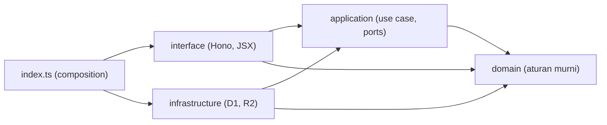

# TRD: Modul `src/claims` dan plafon klaim

Status: draft, 2026-10-21. Data dummy, untuk lab. Dasar: [PRD](PRD.md), [ARCHITECTURE](ARCHITECTURE.md), `CLAUDE.md`. Keputusan struktur dicatat di [ADR 0001](adr/0001-claims-feature-module.md).

Dokumen ini tidak mengubah code. Isinya rencana, dalam dua bagian yang dikerjakan di waktu berbeda:

| Bagian | Isi | Kapan | Behavior |
|---|---|---|---|
| **A. Refactoring** | Memindahkan logika klaim ke `src/claims` | Sekarang | Tidak berubah |
| **B. Plafon** | Migration, aturan plafon, kontrak API, perubahan edit admin | Nanti, setelah A selesai dan PRD disetujui | Berubah sesuai PRD |

Alasan dipisah: kalau test hijau sebelum dan sesudah bagian A tanpa mengubah satu pun test lama, kita tahu pemindahan itu aman. Bagian B lalu menambah aturan di struktur yang sudah rapi, dan setiap perubahan behavior terlihat sebagai perubahan test.

Legenda: **[Terverifikasi]** dibaca dari kode atau dokumen di repo. **[Asumsi]** belum dibuktikan, harus dicek sebelum langkah yang bergantung padanya.

## 1. Kondisi sekarang

**[Terverifikasi]** dari `src/`, `test/`, `migrations/` per 2026-10-21 (total 573 baris).

| Masalah | Bukti |
|---|---|
| Orkestrasi klaim ada di dua handler yang menyalin pola yang sama: validasi, lalu `INSERT`. | `src/api.ts:25-35`, `src/web.tsx:148-156` |
| `src/web.tsx` (249 baris) mencampur login, token, klaim, CSS, dan view. | `src/web.tsx` |
| Aturan akses "sales hanya miliknya" ditulis ulang di setiap handler. | `src/api.ts:18`, `src/web.tsx:92` |
| Query SQL tersebar di handler, tidak ada satu tempat untuk pernyataan bersyarat plafon. | `src/api.ts`, `src/web.tsx` |
| Test hanya menyentuh `validateClaim`. Tidak ada test route. | `test/validate.test.ts` |
| Fake D1 hanya menerapkan `0001` dan `0002`. | `test/helpers/env.ts:10` |

**Catatan data seed.** `0002_seed.sql` sudah berisi klaim Oktober 2026 untuk Rina: `transport` Rp85.000 (`approved`) dan `makan_klien` Rp420.000 (`submitted`). Budi punya `hotel` Rp650.000. Contoh PRD "bulan kosong" di 2026-10 tidak berlaku untuk Rina. Test plafon memakai bulan yang tidak ada di seed (mis. 2026-12) atau menghapus klaim seed di awal test.

## 2. Struktur target `src/claims`

```text
src/claims/
  domain/
    claim.ts              Category, CATEGORIES, ClaimStatus, Claim, ClaimInput
    validate-claim.ts     validateClaim (pindahan dari src/validate.ts, tetap murni)
    limit.ts              [B] monthOf, COUNTED_STATUSES, evaluateLimit, needsLimitCheck
  application/
    ports.ts              ClaimRepository, ReceiptStore, Clock, Viewer
    create-claim.ts
    update-claim.ts
    list-claims.ts
    change-status.ts
    delete-claim.ts
    attach-receipt.ts
  infrastructure/
    d1-claim-repository.ts   semua SQL klaim, prepare(...).bind(...)
    r2-receipt-store.ts
  interface/
    api-routes.ts         route Hono /api/claims*
    web-routes.tsx        route Hono /claims*, /, /receipts/:id, ClaimForm, tabel
    labels.ts             LABEL kategori, format rupiah
    messages.ts           [B] teks penolakan plafon, dipakai Web dan API
  index.ts                composition root: merakit dependency, mengekspor claimsApi dan claimsWeb
```

Di luar modul, yang tetap di tempatnya: `src/auth.ts`, `src/index.tsx`, `mcp/server.ts`, login dan token di `src/web.tsx`. Dua hal diekstrak supaya modul tidak mengimpor `web.tsx`: `Page`, `CSS`, `rupiah` ke `src/ui/page.tsx`, dan `adminOnly` ke `src/auth.ts`.

### 2.1 Dependency rule

Panah berarti "boleh mengimpor". Arah selalu ke dalam.



| Layer | Boleh mengimpor | Tidak boleh |
|---|---|---|
| `domain` | Tidak ada, selain file `domain` lain | `hono`, `D1Database`, `R2Bucket`, `Date.now()`, `fetch`, apa pun dari layer lain |
| `application` | `domain` | `hono`, `D1Database`, `R2Bucket`, `infrastructure`, `interface`, `src/auth`, `src/ui` |
| `infrastructure` | `application` (hanya untuk tipe port), `domain`, tipe `@cloudflare/workers-types` | `interface`, `hono` |
| `interface` | `application`, `domain`, `hono`, `src/auth`, `src/ui` | `infrastructure` |
| `index.ts` | Semua | - |

Konsekuensi yang disengaja:

- `interface` menerima fungsi `getDeps(env)` dari `index.ts`. Dengan begitu handler tidak mengenal D1 dan satu-satunya file yang tahu implementasi konkret adalah `index.ts`.
- `application` memakai tipe `Viewer = { id: number; role: "admin" | "sales" }` miliknya sendiri, bukan `User` dari `src/auth.ts`. `User` cocok secara struktur, jadi tidak perlu mapper.
- Aturan akses "sales hanya miliknya" pindah ke use case (`list-claims.ts`, `create-claim.ts`), ditulis sekali dan dipakai Web dan API. Penegakannya tetap di sisi server, sesuai `CLAUDE.md`.
- Tidak ada class, DI container, atau mapper antar layer. Use case adalah fungsi `(deps, input) => Promise<Result>`, port adalah objek bertipe interface.

### 2.2 Port

```ts
// application/ports.ts (bentuk, bukan code final)
type Viewer = { id: number; role: "admin" | "sales" };

interface ClaimRepository {
  insert(ownerId: number, input: ClaimInput): Promise<{ id: number; status: ClaimStatus }>;
  update(id: number, input: ClaimInput): Promise<void>;               // A: UPDATE tanpa pre-read
  listSummaries(f: { ownerId?: number; status?: string; limit: number }): Promise<ClaimSummary[]>;
  listWithSales(f: { ownerId?: number; status?: string }): Promise<ClaimWithSales[]>;
  findReceiptInfo(id: number): Promise<{ userId: number; status: ClaimStatus } | null>;
  setReceiptKey(id: number, key: string): Promise<void>;
  setStatusIfSubmitted(id: number, status: "approved" | "rejected"): Promise<void>;
  getReceiptKey(id: number): Promise<string | null>;
  remove(id: number): Promise<void>;
}

interface ReceiptStore { put(key: string, body: ArrayBuffer, contentType: string): Promise<void>; delete(key: string): Promise<void>; }
interface Clock { now(): number }   // untuk key struk, supaya bisa di-test
```

Dua method `list*` sengaja terpisah: proyeksi, `LIMIT 50`, dan urutan keduanya berbeda hari ini (`src/api.ts:15-21` dan `src/web.tsx:90-95`). Menyatukannya akan mengubah behavior (mis. urutan saat tanggal sama), jadi ditunda dan bukan bagian dari refactoring ini.

Di bagian B port bertambah: `findById`, `insertWithinLimit`, `updateWithinLimit`, `usage`, `limitFor`. Lihat bagian 5.

## 3. Bagian A: refactoring tanpa mengubah behavior

Aturan untuk semua langkah A:

1. Behavior yang terlihat dari luar tidak berubah: status HTTP, bentuk JSON, redirect, urutan baris, isi pesan error. **Bug yang sudah tercatat (F-3, F-4, F-8, F-9) dipertahankan**, bukan diperbaiki. Perbaikan masuk bagian B atau backlog terpisah.
2. Test yang dibuat di A0 tidak boleh diubah setelahnya. Kalau satu langkah membutuhkan perubahan test A0, langkah itu mengubah behavior dan harus dibatalkan.
3. Setiap langkah selesai dengan `npm test` hijau dan `npx tsc --noEmit` bersih, lalu satu commit. Langkah berikutnya tidak dimulai dari keadaan merah.
4. Tidak ada migration, tidak ada perubahan skema, tidak ada dependency baru.

### A0. Characterization test (jaring pengaman)

Tulis test yang mengunci behavior sekarang lewat `app.request(path, init, env)` pada `src/index.tsx` dengan `createTestEnv()`. Tambah helper `loginAs(env, userId)` di `test/helpers/` yang menyisipkan baris `sessions` dan mengembalikan cookie `sid`.

File: `test/claims/characterization.test.ts`. Cakupan minimum:

| Area | Yang dikunci |
|---|---|
| `POST /api/claims` | 201 `{claim:{id,status:"submitted"}}`; `user_id` dari token walau body mengirim lain; 400 `{error}` untuk nominal 0, kategori salah, tanggal salah, > Rp50.000.000; 401 tanpa token; 403 tanpa scope |
| `GET /api/claims` | Sales hanya miliknya, admin semua; filter `status`; `has_receipt` bernilai `0` atau `1` (bukan boolean); maksimal 50 baris; urutan `claim_date DESC` |
| `PUT /api/claims/:id/receipt` | 404 bukan pemilik; 409 bukan `submitted`; 415 tipe salah; 413 kosong atau > 5 MB; sukses menyimpan `receipt_key` dan objek di R2; upload ulang menyisakan objek lama (F-9) |
| `POST /claims/new` | Redirect `/` dan baris tersimpan dengan `user_id` sesi; 400 dengan form terisi ulang dan `div.err` |
| `POST /claims/:id/edit` | 403 untuk sales; admin bisa ubah klaim `submitted`, `approved`, dan `rejected` (F-4); id tidak ada: redirect `/` tanpa error (F-3); 400 saat tidak valid |
| `POST /claims/:id/status` | Hanya `submitted` yang berubah; nilai status selain `approved` atau `rejected` memberi 400 |
| `POST /claims/:id/delete` | Baris dan objek R2 hilang; klaim `approved` juga bisa dihapus (F-8) |
| `GET /`, `GET /receipts/:id` | Sales hanya miliknya, admin semua; struk milik orang lain 404 |

Selesai bila test ini hijau terhadap code **yang belum diubah**. Ini bukti bahwa test menguji behavior asli, bukan behavior hasil refactoring.

### A1. Kerangka domain dan boundary test

- Buat `domain/claim.ts` (`CATEGORIES`, `Category`, `ClaimInput`, `ClaimStatus`) dan `domain/validate-claim.ts` (isi `validateClaim` dipindah tanpa perubahan).
- `src/validate.ts` menjadi satu baris re-export dari modul baru. Import lama di `api.ts`, `web.tsx`, dan `test/validate.test.ts` tetap berfungsi.
- Tambah `test/claims/architecture.test.ts`: membaca semua file di `src/claims/<layer>/` lalu memeriksa `import` dan identifier terlarang menurut tabel 2.1. Test ini dibuat sekarang dengan aturan untuk semua layer, jadi layer yang muncul belakangan langsung terikat.

Test pembuktian: `test/validate.test.ts` lama lolos tanpa diubah (lewat shim). `architecture.test.ts` hijau; sebagai uji negatif sekali jalan, tambahkan sementara `import "hono"` di `domain/claim.ts`, pastikan test merah, lalu hapus.

### A2. Ekstrak `src/ui` dan `adminOnly`

Pindah murni: `CSS`, `Page`, `rupiah` ke `src/ui/page.tsx`; `adminOnly` ke `src/auth.ts`. `web.tsx` mengimpor dari sana. Tujuan: modul klaim nanti tidak perlu mengimpor `web.tsx` (akan membuat siklus).

Test pembuktian: A0 hijau tanpa perubahan. Tidak ada test baru, karena tidak ada logika baru.

### A3. Buat klaim: port, repository, use case

- `application/ports.ts` (bagian `insert`), `application/create-claim.ts`, `infrastructure/d1-claim-repository.ts` (method `insert`), `index.ts` berisi `makeDeps(env)`.
- `create-claim.ts` memanggil `validateClaim`, lalu `repo.insert(viewer.id, value)`. Mengembalikan `{ok:false,error}` atau `{ok:true,claim}`.
- `POST /api/claims` dan `POST /claims/new` memanggil use case itu. Keduanya tetap memetakan hasil sendiri: API ke 400/201, Web ke form atau redirect.
- Handler tetap di `src/api.ts` dan `src/web.tsx` pada langkah ini. Yang pindah hanya orkestrasi dan SQL.

Test pembuktian: A0 hijau. Baru: `test/claims/create-claim.test.ts` (use case dengan fake `ClaimRepository` di memori, tanpa D1 dan tanpa HTTP) dan `test/claims/d1-claim-repository.test.ts` (method `insert` di fake D1: status default `submitted`, `user_id` sesuai argumen).

### A4. Daftar klaim

- `application/list-claims.ts`: menerapkan aturan akses (`role !== "admin"` berarti `ownerId = viewer.id`), meneruskan filter `status`. Satu varian untuk API (`listSummaries`, `limit: 50`) dan satu untuk Web (`listWithSales`).
- Repository mempertahankan pola yang ada: teks SQL tersusun dari potongan tetap, nilai lewat `bind`. Tidak ada nilai dari user yang masuk ke teks SQL.
- Total di halaman Web (`web.tsx:96`, "tanpa yang ditolak") tetap dihitung di view. Pemusatan definisinya ditunda ke B (F-7).

Test pembuktian: A0 hijau. Baru: unit test `list-claims` (viewer sales tidak pernah menghasilkan filter tanpa `ownerId`; admin tanpa filter) dan test repository untuk kedua method, termasuk bentuk `has_receipt`.

### A5. Edit, ubah status, hapus

- `update-claim.ts`: validasi, lalu `repo.update(id, value)`. **Tidak ada pre-read**: id yang tidak ada tetap diam-diam redirect (F-3), status tidak dicek (F-4).
- `change-status.ts`: `setStatusIfSubmitted`. Validasi nilai status (`approved` atau `rejected`) tetap di use case karena hasilnya 400 di Web.
- `delete-claim.ts`: baca `receipt_key`, `ReceiptStore.delete` dulu, lalu `repo.remove`. Urutan ini dipertahankan walau tidak atomik (F-8).
- `r2-receipt-store.ts` dibuat di langkah ini.

Test pembuktian: A0 hijau. Baru: unit test tiap use case dengan fake repository dan fake `ReceiptStore`. Untuk delete, test mencatat urutan panggilan (store dulu, repo kemudian), supaya urutan yang disengaja itu terkunci.

### A6. Upload struk

- `attach-receipt.ts` menerima `{ viewer, claimId, contentType, body }` dan mengembalikan salah satu: `not_found`, `not_submitted`, `bad_type`, `too_large`, `ok`. Pemetaan ke 404, 409, 415, 413 tetap di `interface`.
- Key struk `receipts/{id}-{clock.now()}.{png|jpg}` memakai `Clock` yang diinjeksi.
- `UPDATE receipt_key` tetap tanpa `AND user_id` dan `AND status` (F-9).

Test pembuktian: A0 hijau. Baru: unit test dengan `Clock` tetap, memastikan key persis `receipts/7-1700000000000.png`.

### A7. Pindahkan route ke `interface`

- `interface/api-routes.ts` dan `interface/web-routes.tsx` menerima `getDeps`. `labels.ts` menampung `LABEL`.
- `src/api.ts` tinggal `requireToken`, `GET /me`, dan `api.route("/claims", claimsApi)`. `src/web.tsx` tinggal login, token, dan `web.route("/", claimsWeb)`.
- Urutan middleware `requireSession` untuk `/`, `/claims/*`, `/receipts/*` tidak berubah: tetap dipasang sebelum route klaim.

Test pembuktian: A0 hijau tanpa perubahan. `architecture.test.ts` hijau dengan `interface` tidak mengimpor `infrastructure`.

### A8. Rapikan

- Hapus shim `src/validate.ts`. Pindah `test/validate.test.ts` ke `test/claims/validate-claim.test.ts` (isi sama, hanya path import).
- Pastikan `grep` tidak menemukan `D1Database` atau `R2Bucket` di `domain/` dan `application/`.

Test pembuktian: seluruh suite hijau; diff A0 terhadap awal bagian A kosong.

### Kriteria selesai bagian A

- [ ] `npm test` dan `npx tsc --noEmit` hijau.
- [ ] `test/claims/characterization.test.ts` tidak berubah sejak A0.
- [ ] `src/api.ts` dan `src/web.tsx` tidak lagi memuat SQL klaim.
- [ ] `architecture.test.ts` ada dan hijau.
- [ ] Tidak ada migration baru, tidak ada route baru, tidak ada Tool MCP baru.
- [ ] Jalan manual sekali: `npm run db:migrate`, `npm run dev`, buat dan edit satu klaim di Web App, dan `create_claim` lewat MCP. Perilaku sama seperti sebelum A.

## 4. Bagian B: implementasi plafon (nanti)

Prasyarat: bagian A selesai, PRD disetujui, tiga asumsi Finance di PRD dijawab atau defaultnya diterima, dan dua **[Asumsi]** di bawah sudah diperiksa.

### 4.1 Skema

`migrations/0003_category_limits.sql`:

```sql
CREATE TABLE category_limits (
  category      TEXT PRIMARY KEY CHECK (category IN ('transport', 'hotel', 'makan_klien', 'lainnya')),
  monthly_limit INTEGER NOT NULL CHECK (monthly_limit > 0)
);

INSERT INTO category_limits (category, monthly_limit) VALUES
  ('transport',   1500000),
  ('makan_klien', 2000000),
  ('hotel',       3000000),
  ('lainnya',      500000);
```

- Satu baris per kategori, sesuai PRD (satu angka untuk semua sales, tanpa tahun). Mengubah plafon = migration baru yang meng-`UPDATE`. Tidak ada route untuk mengubahnya (AC-29).
- Tabel `claims` tidak disentuh. Tidak ada index baru: query pemakaian memfilter `user_id`, `category`, dan bulan dari `claim_date` dengan data sebesar ini tidak perlu diukur ulang sekarang. Kalau nanti lambat, index diputuskan terpisah karena PRD melarang perubahan skema `claims`.
- Data lama yang sudah melewati plafon tidak diubah dan migration tidak memeriksanya (non-goal PRD).
- `test/helpers/env.ts` menambah `0003_category_limits.sql` ke daftar migration (F-6). Fake D1 menjalankan file yang sama dengan wrangler.

### 4.2 Aturan di domain

`domain/limit.ts`, semua fungsi murni:

```ts
const COUNTED_STATUSES = ["submitted", "approved"] as const;
monthOf(claimDate: string): string                       // claimDate.slice(0, 7), tanpa zona waktu
evaluateLimit(p: { used: number; amount: number; limit: number }):
  { ok: true } | { ok: false; used: number; limit: number; remaining: number }
  // ok bila used + amount <= limit; remaining = max(0, limit - used)
needsLimitCheck(before: Pick<Claim,"status"|"amount"|"category"|"claim_date">, after: ClaimInput): boolean
  // false bila before.status bukan COUNTED (AC-20)
  // false bila amount, category, dan monthOf(claim_date) tidak berubah (AC-21)
```

`needsLimitCheck` dipisah supaya AC-20 dan AC-21 bisa diuji tanpa database.

### 4.3 Kontrak API

**Penolakan plafon**, `POST /api/claims` (dan endpoint edit apa pun yang kelak ada):

```http
HTTP/1.1 422 Unprocessable Content
Content-Type: application/json

{
  "error": "Plafon transport 2026-10 terlampaui: terpakai Rp1.000.000 dari Rp1.500.000, sisa Rp500.000.",
  "category": "transport",
  "limit": 1500000,
  "used": 1000000,
  "remaining": 500000
}
```

| Field | Tipe | Arti |
|---|---|---|
| `error` | string | Teks dari `interface/messages.ts`. Menyebut kategori, bulan `YYYY-MM`, terpakai, plafon, dan sisa. |
| `category` | string | Kategori klaim yang ditolak. |
| `limit` | integer | Plafon per sales per bulan, rupiah. |
| `used` | integer | Pemakaian pemilik klaim di kategori dan bulan itu, **tidak termasuk** klaim yang sedang diedit. |
| `remaining` | integer | `max(0, limit - used)`. |

Aturan kontrak:

- Hanya plafon yang memakai 422. Validasi input lain tetap 400 (`{ error }` saja). Ini pengecualian yang disengaja (F-5): 400 berarti input salah, 422 berarti input sah tetapi melanggar aturan bisnis. Dicatat di sini supaya klien tidak mencari pola lain.
- Semua angka bilangan bulat rupiah, tanpa desimal, tanpa string.
- Response sukses `201 {claim:{id,status}}` tidak berubah.
- Response hanya memuat pemakaian pemilik klaim (AC-26). Pada `POST /api/claims` pemilik adalah pemilik token. Pada edit admin, pemilik adalah `claims.user_id`, bukan admin yang mengedit (AC-19).
- MCP `create_claim` tidak berubah. `call` sudah meneruskan `HTTP 422 {json}` dengan `isError: true` (`mcp/server.ts:16`, AC-25).
- **Tidak ada** endpoint untuk membaca atau mengubah plafon, dan tidak ada endpoint edit atau approve baru (AC-29, non-goal PRD).

**Web App**, `POST /claims/new` dan `POST /claims/:id/edit`: form tetap terbuka dengan isian sebelumnya, `div.err` berisi teks yang sama dengan `error` di atas (AC-24). Status HTTP: default **422**, supaya konsisten dengan API. Ini keputusan terbuka nomor 1 di bagian 6.

### 4.4 Port dan SQL

Tambahan pada `ClaimRepository`:

```ts
findById(id: number): Promise<Claim | null>;
insertWithinLimit(ownerId: number, input: ClaimInput): Promise<{ ok: true; claim: {id:number;status:ClaimStatus} } | { ok: false }>;
updateWithinLimit(id: number, ownerId: number, input: ClaimInput): Promise<{ ok: boolean }>;
usage(p: { ownerId: number; category: Category; month: string; excludeId?: number }): Promise<number>;
limitFor(category: Category): Promise<number | null>;
```

**Insert bersyarat**: satu statement, supaya pengecekan dan penulisan tidak terpisah (PRD Constraint, F-2):

```sql
INSERT INTO claims (user_id, category, amount, claim_date, merchant, note)
SELECT ?1, ?2, ?3, ?4, ?5, ?6
WHERE (
  SELECT COALESCE(SUM(amount), 0) FROM claims
  WHERE user_id = ?1 AND category = ?2
    AND substr(claim_date, 1, 7) = substr(?4, 1, 7)
    AND status IN ('submitted', 'approved')
) + ?3 <= (SELECT monthly_limit FROM category_limits WHERE category = ?2)
RETURNING id, status
```

**Update bersyarat** (hanya bila `needsLimitCheck` benar): sama, tetapi `UPDATE claims SET ... WHERE id = ?1 AND user_id = ?2 AND (SELECT ... AND id != ?1) + amountBaru <= limit RETURNING id`. `id != ?1` mengeluarkan klaim yang sedang diedit dari pemakaian (aturan 5 PRD). Bila tidak perlu cek, memakai `UPDATE` biasa.

Penanganan hasil:

1. `RETURNING` kosong berarti ditolak. Use case lalu memanggil `usage` dan `limitFor` untuk membangun `used` dan `remaining`. Angka itu dibaca terpisah dari statement penolakan, jadi pada beban bersamaan bisa bergeser sedikit. Ini informasi untuk pesan saja, bukan dasar keputusan.
2. `limitFor` bernilai `null` (kategori tanpa baris plafon) diperlakukan sebagai **error server (500)**, bukan lolos dan bukan "terlampaui". Subquery plafon yang `NULL` membuat `WHERE` tidak pernah benar, jadi tanpa penanganan ini kasus itu tampil sebagai penolakan palsu. CHECK pada `category_limits` dan `claims` menjaga ini tidak terjadi dalam kondisi normal.
3. Pada edit, `RETURNING` kosong juga bisa berarti klaim terhapus di antara `findById` dan `UPDATE`. Use case membedakannya dengan `findById` ulang: tidak ada berarti 404.

Semua memakai `prepare(...).bind(...)`. Parameter bernomor (`?1`) dipakai supaya nilai yang sama tidak di-bind dua kali.

**[Asumsi] 1**: D1 menerima parameter bernomor `?NNN`, `INSERT ... SELECT ... RETURNING`, dan hasilnya terbaca lewat `.first()`. Fake D1 (`node:sqlite`) menerimanya, tetapi itu bukan bukti untuk D1. Periksa ke docs resmi Cloudflare D1 dan jalankan sekali di `wrangler dev` sebelum B3. Bila `?NNN` tidak didukung, ganti dengan `?` posisional dan bind berulang.

**[Asumsi] 2**: "Worker tidak punya transaksi multi-statement yang aman" di PRD belum diperiksa ke docs D1 (ARCHITECTURE bagian 5). Keputusan satu statement bersyarat tetap benar karena pola cek-lalu-tulis tidak aman walau ada `batch()`. Alasan di PRD sebaiknya diganti setelah dicek.

### 4.5 Perubahan di edit admin

`update-claim.ts` berubah dari "UPDATE langsung" menjadi:

1. `findById(id)`. Tidak ada: 404 (hari ini redirect diam-diam, F-3). **Ini perubahan behavior yang disengaja**, dibutuhkan AC-19 sampai AC-21.
2. `validateClaim` seperti sekarang.
3. `needsLimitCheck(lama, baru)`. Salah: `UPDATE` biasa. Benar: `updateWithinLimit(id, claim.user_id, baru)`.

Edit klaim `approved` tetap boleh (F-4); karena `approved` dihitung, perubahannya lewat pengecekan yang sama. Keputusan terbuka nomor 2.

## 5. Rencana bertahap bagian B

Urutan test-first: tulis test (merah), baru implementasi (hijau). Aturan yang sama dengan A: satu langkah, satu commit, `npm test` hijau.

| Langkah | Perubahan | Test | AC |
|---|---|---|---|
| **B0** | `0003` masuk ke `test/helpers/env.ts`. Helper `seedClaim(env, {...})` untuk menyiapkan pemakaian. | Test tabel kosong gagal dulu (merah), lalu hijau setelah B1 | - |
| **B1** | `migrations/0003_category_limits.sql` | `test/claims/limits-migration.test.ts`: 4 baris dengan nilai PRD | AC-1 |
| **B2** | `domain/limit.ts` | `test/claims/domain/limit.test.ts`, murni: batas `used + amount == limit` diterima, `+1` ditolak; `monthOf("2026-10-31")` vs `"2026-11-01"`; `needsLimitCheck` untuk `rejected` dan untuk edit hanya `note` | AC-4, 5, 11 (sebagian), 13, 20, 21 |
| **B3** | Port baru dan implementasi D1: `usage`, `limitFor`, `insertWithinLimit`, `updateWithinLimit`, `findById` | `test/claims/d1-claim-repository.test.ts` di fake D1: akumulasi, `rejected` tidak dihitung, pisah kategori, bulan, sales; `excludeId` pada edit; dua `insertWithinLimit` berurutan, sisa muat satu, hasil satu ok dan satu tidak | AC-4 sampai 13, 16, 27 (lihat catatan) |
| **B4** | `create-claim.ts` memakai `insertWithinLimit`, mengembalikan `limit_exceeded` dengan `used/limit/remaining`. `interface/messages.ts`. | Test use case dengan fake repo (pemetaan hasil, kategori tanpa plafon jadi error server) | AC-3, 23 |
| **B5** | `POST /api/claims` memetakan `limit_exceeded` ke 422 dengan JSON kontrak | Test route: 201 pada Rp1.500.000, 422 pada Rp1.500.001, tidak ada baris baru, JSON persis lima field berisi bilangan bulat | AC-2, 3, 23, 26 |
| **B6** | `POST /claims/new` menampilkan `div.err` dengan isian terjaga | Test route: status 422, `div.err` menyebut kategori, bulan, plafon, sisa; nilai input masih ada | AC-24 |
| **B7** | `update-claim.ts` seperti 4.5; `POST /claims/:id/edit` memetakan hasil; pesan memakai pemilik klaim | Test route: seluruh AC-14 sampai AC-21 termasuk `amount` tetap pada penolakan dan id tak ada 404 | AC-14 sampai 22 |
| **B8** | Satu sumber untuk "status yang dihitung": total di daftar Web memakai `COUNTED_STATUSES`-turunan (F-7) | Test A0 tentang total tetap hijau, hasil tidak berubah karena `approved` dan `submitted` sama dengan "bukan rejected" saat ini | - |
| **B9** | Pemeriksaan AC-28 dan AC-29 | `test/claims/guards.test.ts`: tidak ada `prepare(` berargumen template berisi `${` di `src/claims/infrastructure`; daftar route tidak memuat path plafon; `mcp/server.ts` tidak mendaftarkan tool approve atau edit | AC-28, 29 |
| **B10** | Jalankan seluruh suite, lalu jalan manual | `npm test` hijau. Manual: `create_claim` lewat MCP mendapat penolakan 422 dengan `isError: true` | AC-25, 30 |

Catatan pengujian:

- **AC-27** (dua request bersamaan): fake D1 berbasis `node:sqlite` sinkron, jadi test B3 membuktikan bahwa pernyataan bersyarat benar secara logika, bukan bahwa D1 sungguhan aman terhadap balapan. Pembuktian balapan nyata butuh `wrangler dev` dengan dua request paralel dan dicatat sebagai pemeriksaan manual.
- **AC-25** (MCP) tidak punya test otomatis karena tidak ada test untuk `mcp/server.ts` dan kodenya tidak berubah. Pemeriksaan manual di B10.
- Karena seed sudah memuat klaim Oktober 2026 (bagian 1), test memakai bulan 2026-12 atau memanggil `seedClaim` setelah mengosongkan `claims`.

## 6. Keputusan terbuka

| # | Pertanyaan | Default di dokumen ini | Pemutus |
|---|---|---|---|
| 1 | Status HTTP form Web saat plafon terlampaui: 400 atau 422? | 422, sama dengan API | Tim engineering |
| 2 | Boleh admin mengubah nominal klaim `approved` (F-4)? | Boleh, dengan pengecekan plafon yang sama | Finance |
| 3 | Tiga asumsi PRD (approve tidak dicek ulang, hapus memulihkan sisa, `rejected` kembali dihitung) | Sesuai default PRD | Finance |
| 4 | Apakah perubahan 404 untuk edit id tidak ada (4.5) diterima? | Ya, karena dibutuhkan AC-19 sampai AC-21 | Tim engineering |

## 7. Di luar dokumen ini

- Perbaikan F-8 (hapus tidak atomik dengan R2), F-9, F-10 sampai F-13. Dicatat di ARCHITECTURE, tidak dikerjakan di refactoring ini.
- Enum kategori di zod `mcp/server.ts:30-36` masih duplikat dari `CATEGORIES`. Tidak disentuh karena `mcp/` di luar `src/claims`.
- Penyatuan dua method `list*` (urutan dan `LIMIT` berbeda).
- Index untuk query pemakaian.
